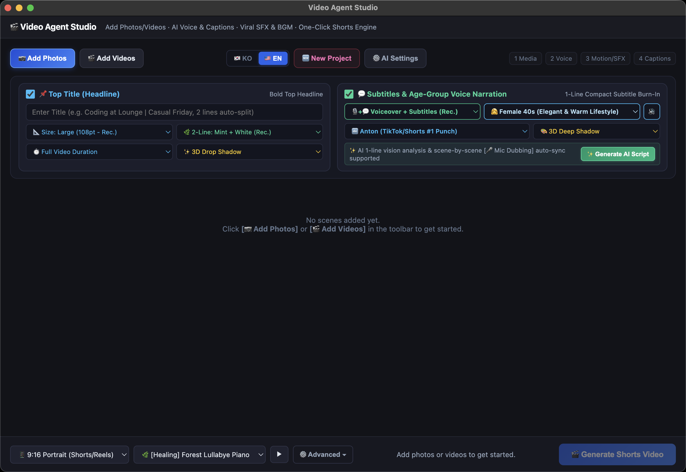

# 🎬 Video Agent Studio

<p align="center">
  
</p>

<p align="center">
  <b>The Open-Source, Zero-Cost AI Shorts & Reels Production Studio</b><br/>
  Powered by Google Gemini 2.5 Flash Multimodal Vision, Local Whisper Speech-to-Text, and FFmpeg Kinetic Motion Engine.
</p>

<p align="center">
  <a href="#-features">Features</a> •
  <a href="#-quick-start">Quick Start</a> •
  <a href="#-troubleshooting--installation-guide-macos--windows">Troubleshooting</a> •
  <a href="#-security--privacy-first">Security & Privacy</a> •
  <a href="#-korean-guide-한국어-설치--보안-해결-가이드">한국어 가이드</a> •
  <a href="#-license">License</a>
</p>

<p align="center">
  
  
  
  
  
</p>

<p align="center">
  <a href="https://github.com/2gosooclass/video-agent-studio/releases/download/v0.8.0/Video.Agent.Studio-0.8.0-arm64.dmg">
    
  </a>
  &nbsp;
  <a href="https://github.com/2gosooclass/video-agent-studio/releases/tag/v0.8.0">
    
  </a>
  &nbsp;
  <a href="https://github.com/2gosooclass/video-agent-studio/releases/latest">
    
  </a>
</p>

---

## 💡 Why Video Agent Studio?

Creating viral short-form videos (YouTube Shorts, Instagram Reels, TikTok) from smartphone photos or raw clips usually requires expensive monthly subscriptions (like Vrew, CapCut Pro) that throttle your usage with artificial credit limits.

**Video Agent Studio** is a 100% free, local-first desktop application that runs entirely on your own hardware using your personal Google Gemini API key:
* **$0 Monthly Bill**: Zero cloud rendering fees, zero credit caps.
* **Instant Multimodal AI**: Gemini 2.5 Flash inspects your photos/videos and drafts punchy, high-retention 1-line scripts with cohesive narrative arcs.
* **Studio-Grade Motion**: Ken Burns zoom-in, tilt-down lookbook panning, filmic fades, and auto-alternating camera choreography.
* **Privacy-First**: Your source media and personal API keys stay strictly on your local machine.

---

## ✨ Key Features

### 1. 📐 Smart EXIF Auto-Orientation Engine
Smartphone photos shot vertically (iPhone/Android with EXIF Orientation 6 or 8) frequently get rendered sideways in FFmpeg. Video Agent Studio uses hardware-accelerated orientation normalization to guarantee your portrait photos stay strictly vertical (9:16) with zero stretching or distortion.

### 2. 💬 Strict 1-Line Subtitle Rule
No more cluttered 4-line subtitles blocking half your video! Our Gemini prompt engineering and typography layout keep narrations compact (15–22 characters in Korean / 8–14 words in English), rendering crisp single-line captions at the bottom with 3D drop shadows and vivid yellow keyword highlights.

### 3. 🎨 Two-Tone Multi-Line Title Styling
When your headline spans two lines or uses `|` (e.g. `Coding at the Lounge | Casual Friday`), Line 1 is styled in vivid Mint (`#34d399`) or Neon Yellow, while Line 2 renders in crisp White (`#FFFFFF`). This delivers the signature aesthetic used by top YouTube Shorts creators.

### 4. 🎙️ 3-Way Flexible Output Modes
Choose the exact output format for your workflow:
* **[🎙️ + 💬 Voiceover + Subtitles]**: Full experience with AI voiceover, synchronized captions, and background music.
* **[🎙️ Voiceover Only]**: Audio-centric videos with subtitles hidden for clean aesthetics.
* **[💬 Subtitles Only]**: Zero-latency silent generation with BGM and subtitles (TTS skipped for 0s wait).

### 5. 🔤 21 Bundled Creator Fonts (Global English + Korean)
Pre-installed and packaged with zero external font dependencies:
* **🇺🇸 10 Global English Fonts**: Anton (TikTok/Shorts #1 Punch), Bebas Neue (Tall Cinematic), Montserrat Bold (Modern Tech), Poppins (Trendy Creator), Oswald (Impact Headline), Inter (Silicon Valley Clean), Playfair Display (Luxury Lookbook), Pacifico (Vibrant Script), Bangers (Viral Meme/Comic), Caveat (Casual Handwriting).
* **🇰🇷 11 Korean Creator Fonts**: S-Core Dream (7/8/9), Jalnan (여기어때 잘난체), Cafe24 Danjunghae, Pretendard Bold, Gmarket Sans, Black Han Sans, Naver Maru Buri, Baemin Do Hyeon, Baemin Jua, Nanum Myeongjo, Nanum Pen.

### 6. 🎬 Kinetic Motion Choreography
* 🔍 **Zoom In** (1.02x -> 1.20x dynamic Ken Burns zoom)
* 🔎 **Zoom Out** (1.20x -> 1.02x smooth reveal zoom)
* ⬇️ **Tilt Down** (Smooth top-to-bottom lookbook pan)
* ⬆️ **Tilt Up** (Bottom-to-top reveal pan)
* ✨ **Filmic Fade** (Gentle cinematic fade in/out)
* 🎬 **Auto-Cycle**: Alternates motion across scenes automatically for effortless production!

### 7. 🎵 Royalty-Free Music & SFX Suite
Bundles 15 categorized BGM tracks (Forest Piano, Harmonica Folk, Acoustic Guitar, Lo-Fi, Neon Synthwave, Rock, Viral Comedy) with intelligent sidechain ducking and `@remotion/sfx` sound effects (whoosh, ding, vine boom, mouse click, page turn).

---

## 🏗️ Architecture

```
[ Smartphone Photos / Raw Clips / Vlogs ]
                    │
                    ▼
┌───────────────────────────────────────────────┐
│              Video Agent Studio               │
│               (Electron Desktop)              │
├───────────────────────────────────────────────┤
│  1. Multimodal Vision & Cohesive Story Engine │
│     └─ Google Gemini 2.5 Flash API (BYOK)     │
│  2. Local Speech-to-Text Transcription       │
│     └─ OpenAI Whisper CLI (ggml-small)        │
│  3. Dual-Layer EXIF Auto-Orientation          │
│     └─ Pillow ImageOps + FFmpeg Auto-Orient   │
│  4. Kinetic FFmpeg Video Renderer             │
│     └─ Zoompan, Lookbook Tilt, Fade Filters   │
│  5. Dynamic Libass Subtitle Burning           │
│     └─ 21 Creator Fonts, 2-Tone Colors        │
│  6. Audio Engine & Sidechain Ducking          │
│     └─ Gemini TTS / Local VoiceBox + SFX      │
└───────────────────────────────────────────────┘
                    │
                    ▼
     [ 1080x1920 Viral 9:16 Shorts Video ]
```

---

## 🚀 Quick Start

### Option A: Pre-built Desktop App (Direct Download)

| Operating System | Installer Format | Direct Download Link | Architecture |
| :--- | :--- | :--- | :--- |
| 🍏 **macOS** | `.dmg` (Disk Image) | [⬇️ **Download macOS DMG (740MB)**](https://github.com/2gosooclass/video-agent-studio/releases/download/v0.8.0/Video.Agent.Studio-0.8.0-arm64.dmg) | Apple Silicon (M1/M2/M3/M4) |
| 🪟 **Windows** | `.exe` (Setup Wizard) | [⬇️ **Download Windows Setup.exe**](https://github.com/2gosooclass/video-agent-studio/releases/tag/v0.8.0) | Windows 10 / 11 (64-bit) |
| 🪟 **Windows Portable** | `.exe` (No Install) | [⬇️ **Download Windows Portable.exe**](https://github.com/2gosooclass/video-agent-studio/releases/tag/v0.8.0) | Windows 10 / 11 (64-bit) |
| 📦 **All Assets** | All Platforms | [🔗 **Browse GitHub Releases (v0.8.0)**](https://github.com/2gosooclass/video-agent-studio/releases/tag/v0.8.0) | Multi-Platform |

> 💡 **macOS First-Launch Note**: If macOS displays *"damaged and can't be opened"* or *"unidentified developer"*, simply run `xattr -cr "/Applications/Video Agent Studio.app"` in Terminal. See [Apple Security Guide](#-troubleshooting--installation-guide-macos--windows) below!
> 
> 💡 **Windows First-Launch Note**: If Windows Defender SmartScreen shows *"Windows protected your PC"*, click **More info** -> **Run anyway**.

### Option B: Run from Source
```bash
# Clone the repository
git clone https://github.com/2gosooclass/video-agent-studio.git
cd video-agent-studio

# Install dependencies
npm install

# Start development app
npm start
```

---

## 🛡️ Troubleshooting & Installation Guide (macOS & Windows)

### 🍎 1. macOS Gatekeeper & Apple Security Warnings

Because Video Agent Studio is an open-source tool without an expensive commercial Apple Developer ID certificate ($99/year), macOS Gatekeeper may display a security popup when opening the app for the first time:

#### Common Popups:
> ⚠️ **"Video Agent Studio" is damaged and can't be opened. You should move it to the Trash.**<br/>
> ⚠️ **"Video Agent Studio" cannot be opened because Apple cannot check it for malicious software.**<br/>
> ⚠️ **"Video Agent Studio" is from an unidentified developer.**

#### 3 Easy Ways to Bypass (Choose Any):

* **Solution 1 (Terminal 1-Liner - Recommended)**:
  Open Terminal and run the following command to remove the macOS download quarantine attribute:
  ```bash
  xattr -cr "/Applications/Video Agent Studio.app"
  ```
  Then double-click the app to open it immediately!

* **Solution 2 (Right-Click Open)**:
  1. Open Finder and navigate to `/Applications`.
  2. **Right-click** (or hold **Control** and click) `Video Agent Studio.app`.
  3. Select **Open** from the context menu.
  4. In the dialog that appears, click **Open**.

* **Solution 3 (macOS System Settings)**:
  1. Try opening the app once. If blocked, go to **System Settings** -> **Privacy & Security**.
  2. Scroll down to the **Security** section.
  3. You will see: *"Video Agent Studio was blocked from use because it is not from an identified developer."*
  4. Click **Open Anyway** and confirm your Mac password or Touch ID.

---

### 🎙️ 2. Microphone Permissions for Voice Dubbing

When you click the `[🎤 Record Voice]` button to record your narration directly:
* macOS will ask: *"Video Agent Studio would like to access the microphone."*
* Click **OK**.
* If you previously clicked "Don't Allow":
  Go to **System Settings** -> **Privacy & Security** -> **Microphone**, and toggle **Video Agent Studio** to **ON**.

---

### 🪟 3. Windows SmartScreen Warning (Windows Users)

When launching `Video Agent Studio-Setup.exe` on Windows:
* Windows Defender SmartScreen may display: *"Windows protected your PC"*.
* Click **More info**.
* Click **Run anyway**.

---

## 🔒 Security & Privacy-First Protocol

* **Zero Hardcoded Secrets**: This repository contains strictly zero API keys, passwords, or confidential credentials.
* **Bring-Your-Own-Key (BYOK)**: Video Agent Studio connects directly from your local client to Google Gemini API servers.
* **Local Storage**: Your Gemini API key is saved exclusively in your local Electron app configuration directory (`~/Library/Application Support/video-agent-studio/settings.json`) with strict user-only read/write permissions. It is never uploaded to any third-party server.
* **Source Media Stays on Your Machine**: Video clips, audio tracks, and photos are processed locally via bundled FFmpeg. No private videos are sent over the cloud.

---

## 🇰🇷 Korean Guide (한국어 설치 & 보안 해결 가이드)

### 📌 비디오 에이전트 스튜디오 (Video Agent Studio) 소개
유튜브 쇼츠, 인스타그램 릴스, 틱톡 영상을 제작할 때 매달 수만 원씩 결제하던 유료 툴(Vrew, CapCut)의 크레딧 제한과 서버 대기 시간을 단번에 해결하는 **100% 무료 오픈소스 데스크톱 제작 스튜디오**입니다.

* **세로 사진 자동 회전**: 스마트폰에서 세로로 찍은 일상 사진이 가로로 뒤집히는 버그를 완벽 해결했습니다.
* **1줄 자막 절대 원칙**: 화면을 가리던 조잡한 3~4줄 자막을 탈피하여, 공백 포함 15~22자의 임팩트 있는 1문장 자막으로 제작합니다.
* **2줄 배색 제목**: 제목이 2줄일 경우 1줄(민트/옐로우), 2줄(화이트)로 대비 색상을 적용하여 숏폼 트렌드 감성을 극대화합니다.
* **3단 출력 모드**: [나레이션+자막], [나레이션만], [자막만] 중 원하는 조합을 클릭 한 번으로 선택할 수 있습니다.
* **한글 11종 & 영문 10종 폰트**: 에스코어 드림, 여기어때 잘난체, 카페24 단정해, 프리텐다드, G마켓 산스, Anton, Bebas Neue 등 인기 크리에이터 폰트 21종을 기본 내장했습니다.

---

### 💾 원클릭 즉시 다운로드 (운영체제별)

| 운영체제 | 파일 형식 | 바로 다운로드 링크 | 지원 환경 |
| :--- | :--- | :--- | :--- |
| 🍏 **맥 (macOS)** | `.dmg` | [⬇️ **맥용 설치 파일 다운로드 (740MB)**](https://github.com/2gosooclass/video-agent-studio/releases/download/v0.8.0/Video.Agent.Studio-0.8.0-arm64.dmg) | Apple Silicon (M1/M2/M3/M4) |
| 🪟 **윈도우 (Windows)** | `.exe` | [⬇️ **윈도우 설치 파일 (Setup.exe)**](https://github.com/2gosooclass/video-agent-studio/releases/tag/v0.8.0) | Windows 10 / 11 (64-bit) |
| 🪟 **윈도우 무설치** | `.exe` | [⬇️ **윈도우 포터블 (Portable.exe)**](https://github.com/2gosooclass/video-agent-studio/releases/tag/v0.8.0) | Windows 10 / 11 (64-bit) |
| 📦 **전체 릴리즈 목록** | All | [🔗 **깃허브 공식 릴리즈 페이지 바로가기**](https://github.com/2gosooclass/video-agent-studio/releases/tag/v0.8.0) | 전체 플랫폼 |

---

### 🚨 맥(macOS) 설치 시 보안 경고 팝업 해결 방법

본 프로그램은 개인 개발자 및 오픈소스 커뮤니티 배포용으로 제작되어, 애플의 연간 99달러 유료 인증서(Apple Developer ID) 서명이 포함되지 않아 게이트키퍼(Gatekeeper) 보안 경고가 나타날 수 있습니다. 이는 애플의 정상적인 보안 절차이며 아래 방법으로 1초 만에 실행하실 수 있습니다.

#### 자주 뜨는 경고 창:
> ⚠️ **"Video Agent Studio" 파일이 손상되었기 때문에 열 수 없습니다. 해당 파일을 휴지통으로 이동해야 합니다.**<br/>
> ⚠️ **확인되지 않은 개발자가 배포했기 때문에 열 수 없습니다.**<br/>
> ⚠️ **악성 소프트웨어가 있는지 확인할 수 없으므로 열 수 없습니다.**

#### 해결 방법 (3가지 중 편한 방법 선택):

* **방법 1 (터미널 명령어 1줄 - 가장 추천)**:
  맥의 [터미널(Terminal)] 앱을 켜고 아래 명령어를 그대로 붙여넣고 엔터를 누르세요:
  ```bash
  xattr -cr "/Applications/Video Agent Studio.app"
  ```
  (인터넷 다운로드 격리 속성인 `com.apple.quarantine`이 해제되어 즉시 정상 실행됩니다.)

* **방법 2 (우클릭 열기)**:
  1. Finder에서 [응용 프로그램(Applications)] 폴더로 이동합니다.
  2. `Video Agent Studio.app` 아이콘 위에서 **마우스 우클릭**(또는 Control 키 누른 채 클릭)합니다.
  3. 메뉴에서 **[열기]**를 클릭합니다.
  4. 팝업 창이 뜨면 **[열기]** 버튼을 누릅니다.

* **방법 3 (시스템 설정)**:
  1. 앱 실행 시도 후 차단 창이 뜨면, 맥의 **[시스템 설정]** -> **[개인정보 보호 및 보안]**으로 이동합니다.
  2. 화면을 아래로 스크롤하여 [보안] 항목을 확인합니다.
  3. *"Video Agent Studio의 사용이 차단되었습니다"*라는 문구 옆의 **[확인 없이 열기]** 버튼을 클릭합니다.

---

### 🎤 마이크 녹음 권한 설정 안내
장면 카드에서 `[🎤 직접 녹음]` 버튼을 누르면 마이크 권한 요청 창이 뜹니다.
* 반드시 **[승인]** 또는 **[허용]**을 눌러주세요.
* 만약 실수로 거부를 눌렀다면: **시스템 설정** -> **개인정보 보호 및 보안** -> **마이크**에서 **Video Agent Studio**를 켜주시면 됩니다.

---

### 🔑 Google Gemini API 키 발급 및 보안 (BYOK)
* [Google AI Studio](https://aistudio.google.com)에서 구글 계정으로 로그인 후 **[Get API key]** 버튼을 누르면 무료 API 키를 즉시 발급받을 수 있습니다.
* 발급받은 키는 프로그램 우측 상단 **[⚙️ AI 설정]**에 입력하시면 됩니다.
* 입력하신 키는 대표님 맥북의 안전한 로컬 저장소(`~/Library/Application Support/video-agent-studio/settings.json`)에만 저장되며, 깃허브나 외부 서버로 절대 전송되지 않습니다.

---

## 🤝 Contributing & Hackathons

We actively welcome contributions, feature suggestions, and bug reports!
This project was designed for global AI competitions and hackathons to showcase the power of multimodal AI paired with local-first, zero-cost desktop computing.

If you like this project, please give it a **⭐ Star** on GitHub!

---

## 📄 License

This project is licensed under the [MIT License](LICENSE).
Font files bundled with the application are licensed under their respective Open Font Licenses (OFL) or creator free-distribution agreements.
